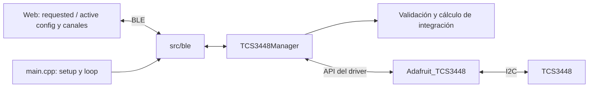

# TCS3448 — Aplicación FW + BLE + Web

Aplicación de caracterización y control del TCS3448 sobre ESP32, PlatformIO y
Arduino. El hito 4 añade un panel de setup remoto al flujo de adquisición debug.
La Web configura y muestra ADC crudos: no implementa análisis, gráficas,
normalización, calibración, DARK/REFERENCE, CSV ni almacenamiento histórico.

## Arquitectura general

```text
Web Browser (interfaz y protocolo de aplicación)
    | Web Bluetooth
    v
src/ble/ — TCS3448BLE (GATT, cola, comandos y ACK)
    |
    v
TCS3448Manager (validación, configuración verificada y adquisición)
    |
    v
Adafruit_TCS3448 (driver y lectura/escritura de registros)
    | I2C
    v
TCS3448
```



La Web usa tiempo en ms, mA, modos de 6/12/18 resultados y opciones de autozero.
No maneja registros, ATIME/ASTEP, direcciones I2C ni enums de Adafruit. BLE solo
interactúa con el gestor. Los callbacks BLE encolan mensajes; el bucle Arduino
valida, accede al hardware y publica respuestas. `main.cpp` sigue siendo pequeño.

La interfaz se organiza en Measurement y Setup dentro del mismo documento, con
navegación `#/measurement` y `#/setup` para conservar BLE. La presentación dark,
los estados, el resumen físico de canales y Advanced Debug se describen en
[ARCHITECTURE.md](ARCHITECTURE.md) y el [README Web](web/README.md).

## Responsabilidades y estructura

| Ruta | Responsabilidad | Detalles |
| --- | --- | --- |
| `src/main.cpp` | Inicialización y ejecución periódica | [src](src/README.md) |
| `src/TCS3448Manager/` | Configuración, LED, adquisición y validación temporal | [README](src/TCS3448Manager/README.md) |
| `src/ble/` | Servicio GATT, sesiones, comandos, ACK y envío | [README](src/ble/README.md) |
| `src/SerialCommand/` | Entrada serie reservada, sin comandos activos | [README](src/SerialCommand/README.md) |
| `lib/Adafruit_TCS3448/` | Driver con lectura verificada de configuración | [README](lib/Adafruit_TCS3448/README.md) |
| `web/src/` | Fuentes editables de interfaz y protocolo | [README](web/src/README.md) |
| `web/dist/` | HTML local autocontenido | [README](web/dist/README.md) |
| `scripts/` | Generación del HTML y comprobaciones simuladas | [README](scripts/README.md) |
| `docs/` | Formatos del protocolo y aceptación en hardware | [Guía BLE/setup](docs/HITO_3_BLE.md) |

`include/` está reservado para cabeceras. `test/` contiene las comprobaciones de
regresión anteriores, adaptadas al setup ([README](test/README.md)). Las nuevas
comprobaciones del hito están en `scripts/verify-setup.mjs`.
`Hitos/` contiene planificación. No existen todavía módulos de análisis,
calibración o almacenamiento; los futuros módulos deben incluir README y seguir
la [plantilla](docs/MODULE_README_TEMPLATE.md).

## Modelos y fuente de verdad

`TCS3448Types.h` define tipos propios sin incluir el driver:

| Modelo | Campos principales |
| --- | --- |
| `TCS3448Config` | gain, integrationMs, ledCurrent uint16, ledEnabled, smux, autozero, sampleIntervalMs; pines/frecuencia I2C solo de arranque |
| `TCS3448Sample` | sequence, timestampMs, 18 posiciones ADC uint16, gain, saturated y channelCount válido |
| `TCS3448Status` | ready, acquiring, error, sampleCount y configRevision |

La configuración activa pertenece al gestor. Se considera conocida (`ready=1`)
solo tras escribir y verificar todos los campos hardware. La revisión aumenta
cuando se confirma una aplicación o se modifica el LED por seguridad. Una
configuración con `ready=0` no debe presentarse como aplicada.

Los códigos de gain son de la aplicación: 0..12 representan 0,5x, 1x, 2x, 4x,
8x, 16x, 32x, 64x, 128x, 256x, 512x, 1024x y 2048x. SMUX usa 6, 12 o 18;
autozero usa Disabled 0, FirstMeasurement 1 y EveryMeasurement 2. El mapping a
registros se realiza en firmware.

## Configuración y validación

| Parámetro | Arranque | Validación definitiva |
| --- | --- | --- |
| Gain | 64x | Uno de los 13 códigos definidos |
| Integration Time | 50,04 ms por ciclo | Finito, rango físico y cuantización válida |
| LED Current | 10 mA | 4..258 mA, pares |
| LED | OFF | Booleano explícito |
| Auto-SMUX | 18 resultados | 6 / 12 / 18 |
| Autozero | Before first measurement cycle | Solo los tres modos soportados |
| Sample Period | 500 ms | Entero 1..2147483647 y al menos el mínimo calculado |
| SDA / SCL / I2C | 4 / 5 / 400 kHz | Se configuran al arrancar; no editables desde Web |

El gestor busca una combinación válida de ATIME/ASTEP para el tiempo solicitado.
Devuelve el tiempo real cuantizado, verificado contra los registros. El protocolo
lo redondea a microsegundos. El ADC full scale se obtiene del producto de pasos
realmente aplicado y se limita a 65535 counts; es de solo lectura.

Sample Period pertenece al planificador de adquisición, no es un registro WTIME.
El mínimo de la aplicación incluye todos los ciclos SMUX, presupuesto de autozero
(20 ms por ciclo relevante) y 10 ms para I2C/planificación. Es un presupuesto
conservador basado en el tiempo típico, no una garantía de tiempo real. El timeout
vigila una adquisición que tarde más. Un periodo insuficiente se rechaza con
`SAMPLE_PERIOD_TOO_SHORT`, en vez de ajustarlo silenciosamente.

Autozero FirstMeasurement significa antes del primer ciclo al iniciar el motor;
EveryMeasurement significa cada ciclo de integración, incluidos los subciclos SMUX.
El flujo usa medidas individuales con inicio/parada: First puede ejecutarse de
nuevo al iniciar la siguiente adquisición. No equivale a «una sola vez por arranque».

## Flujo completo de configuración

```mermaid
sequenceDiagram
    participant W as Web
    participant B as BLE
    participant M as TCS3448Manager
    participant D as Driver / sensor
    W->>B: GET_CONFIG tras conectar
    B->>M: RefreshConfig()
    M->>D: Lectura comprobada de registros
    B-->>W: Estado + CONFIG verificada
    W->>W: Rellenar REQUESTED y ACTIVE
    W->>B: APPLY_CONFIG con todos los campos
    B->>M: ApplyConfig(candidate)
    M->>M: Validar TODOS los campos
    alt Candidato inválido
        M-->>B: Error, sin escrituras ni cambios de adquisición
    else Candidato válido
        M->>D: Pausar medida, escribir y leer configuración
        alt Escritura y verificación correctas
            M->>M: Confirmar configuración y reanudar si estaba RUNNING
        else Fallo hardware
            M->>D: Restaurar configuración anterior y verificar
            M->>M: Detener; marcar UNKNOWN si rollback no se confirma
        end
    end
    B-->>W: Publicar CONFIG antes de CONFIG_ACK en STATUS
    W->>B: Leer CONFIG tras confirmar respuesta
    W->>W: Actualizar ACTIVE; nunca éxito anticipado
```

La validación se completa antes de cualquier escritura. Un rechazo conserva
configuración y adquisición. Si el fallo ocurre durante la escritura, se intenta
rollback de todos los ajustes. Un rollback verificado conserva la configuración
anterior, pero deja la adquisición detenida; si no se verifica, `ready=0` y se
requiere revisar el hardware/reiniciar. No se promete atomicidad eléctrica de
varias transacciones I2C: se garantiza validación previa y no se confirma un
candidato parcial.

La Web mantiene un formulario REQUESTED separado de ACTIVE CONFIGURATION.
GET_CONFIG verifica la configuración del gestor contra el hardware. APPLY publica
la configuración activa y luego confirma mediante STATUS. En éxito el formulario
se actualiza con valores reales; en rechazo conserva los datos solicitados y
muestra el error. No hay persistencia de cambios tras reiniciar el ESP32.

## Protocolo BLE

Nombre anunciado: **TCS3448**. Servicio:
`34480001-7f2a-4f6c-9e31-8dbe0c2f5a70`.

| Característica | Prefijo UUID; mismo sufijo que el servicio | Propiedades |
| --- | --- | --- |
| STATUS | `34480002` | Read + Notify, 20 bytes |
| COMMAND | `34480003` | Write con respuesta |
| SAMPLE | `34480004` | Notify, cuatro fragmentos de 20 bytes |
| CONFIG | `34480005` | Read, 20 bytes |

Se conserva el protocolo binario previo, sin añadir JSON ni otra fragmentación.
STATUS y SAMPLE mantienen versión 1. CONFIG pasa a versión 2 con campos de alto
nivel; exige usar el firmware y el HTML del hito 4 juntos. Los UUID no cambian.

START, STOP, GET_STATUS y GET_CONFIG siguen siendo texto ASCII exacto, sin CR/LF.
APPLY_CONFIG es un único paquete binario de 20 bytes etiquetado `0xA4`, con versión
CONFIG 2 y todos los parámetros. La palabra ASCII APPLY_CONFIG sola no incluye
los parámetros y se rechaza. Véanse [offsets y códigos](docs/HITO_3_BLE.md#servicio-gatt-v1).

La escritura GATT acepta el mensaje, no confirma su ejecución. El ACK de aplicación
usa último comando, resultado, error y contador de respuestas en STATUS. Para APPLY,
CONFIG se prepara antes de publicar ese ACK y se lee a continuación. La Web envía
una orden cada vez y espera hasta 5 s; ante timeout no supone éxito y exige volver
a consultar la configuración. La cola tiene ocho órdenes y descarta sesiones antiguas.

## Adquisición, START / STOP y muestras

START activa el planificador, no modifica el ajuste LED. STOP cancela la medida y
la transmisión pendiente; tampoco cambia el LED. Es posible iluminar estando
STOPPED o medir con LED OFF. El arranque por defecto deja el LED OFF; habilitarlo
mediante APPLY si se desea iluminación interna.

`Update(sample)` inicia una medida cuando corresponde y sondea su finalización en
llamadas posteriores. No espera la integración en un bucle; las transacciones I2C
sí son síncronas. Lee una instantánea de canales, gain y saturación, detiene esa
medida e incrementa la secuencia. La próxima medida no se solapa con la anterior.

La muestra mantiene 48 bytes, pero `channelCount` indica 6, 12 o 18 resultados
válidos; el resto se rellena con cero y no se muestra. Los nombres/orden son parte
del protocolo de aplicación, no registros expuestos a JavaScript. La secuencia y
el timestamp son uint32; el timestamp corresponde a detectar el resultado, no al
inicio exacto de exposición. Secuencia y timestamp pueden desbordarse. STOP y
APPLY no reinician la secuencia.

Las notificaciones se espacian al menos 15 ms. No se reemplaza una transmisión a
medias por otra: si llega una muestra mientras se envía la anterior, se omite su
envío. No hay retransmisión ni histórico. La Web descarta muestras incompletas,
fuera de orden o inconsistentes; solo muestra conjuntos completos y contabiliza
saltos entre secuencias recibidas. APPLY cancela los fragmentos pendientes para
no continuar una muestra de la configuración anterior.

## Conexión, reconexión y errores

Connect descubre el servicio, obtiene características y activa suscripciones.
Después solicita GET_STATUS y GET_CONFIG: tanto los controles como RUNNING/STOPPED
proceden del firmware. No se recuperan valores activos de una conexión anterior.

La desconexión cancela adquisición y apaga el LED en el siguiente ciclo del bucle.
Ese apagado actualiza la configuración del gestor; al reconectar se lee LED OFF.
El anuncio BLE se reactiva después de 200 ms. La Web limpia estado, formulario y
reconstrucción pendiente; al reconectar vuelve a consultar y no inicia adquisición.

Los errores de validación son INVALID_GAIN, INVALID_INTEGRATION,
INVALID_LED_CURRENT, INVALID_SMUX_MODE, INVALID_AUTOZERO,
INVALID_SAMPLE_PERIOD y SAMPLE_PERIOD_TOO_SHORT. Payload incorrecto devuelve
INVALID_CONFIG_PAYLOAD; fallo de aplicación o rollback devuelve CONFIG_APPLY_FAILED.
Los fallos de adquisición I2C/timeout intentan apagar LED y detener el sensor.
Los logs Serial explican recepción, validación, aplicación y ACK, sin imprimir cada loop.

## Arrancar y probar

1. Conectar el sensor con alimentación/niveles compatibles y SDA/SCL configurados.
2. Compilar y cargar por USB desde PlatformIO, entorno `esp32dev`:

   ```powershell
   pio run -e esp32dev
   pio run -e esp32dev -t upload
   pio device monitor -b 115200
   ```

3. Abrir `web/dist/index.html` con doble clic en un navegador que permita Web
   Bluetooth en archivos locales, con Bluetooth activo. El HTML no necesita
   servidor, Node ni Internet para utilizarse.
4. Connect → TCS3448 desde Measurement. Comprobar IDLE (STOPPED del firmware).
5. Ir a Setup: revisar ACTIVE y seleccionar gain, integración en ms, corriente/estado
   LED, SMUX, autozero y periodo. APPLY CONFIGURATION y esperar CONFIGURATION VALID.
6. Volver a Measurement, Start y navegar a Setup durante RUNNING. Cambiar ajustes
   con APPLY y volver al readout sin desconectar. Comprobar los cambios en los ADC.
7. Stop y comprobar que cesan muestras; el LED respeta su ajuste independiente.
   Desconectar/reconectar: debe quedar STOPPED y LED OFF, con el resto de ajustes
   recuperados del ESP32. Reiniciar el ESP32 restaura valores de arranque.
8. Seguir la [matriz de aceptación](docs/HITO_3_BLE.md#pasos-de-aceptación-en-hardware)
   para validaciones, errores, SMUX y continuidad en hardware.

La flash usa `huge_app.csv`: una aplicación de 3 MiB en flash de 4 MiB, sin segunda
partición OTA. Cargar cambios por USB. La Web y la documentación no ocupan flash.

Para editar/verificar la Web, desde la raíz:

```powershell
node --check web/src/app.mjs
node --check web/src/ui.mjs
node --check web/src/protocol.mjs
node scripts/build-web.mjs
node scripts/verify-setup.mjs
node test/web_protocol.test.mjs
node test/web_app.test.mjs
```

Editar `web/src/`, no `web/dist/index.html`: este último se regenera y se puede
copiar solo o publicar después en GitHub Pages. El verificador ejecuta el script
del HTML con GATT simulado; no verifica el driver, la radio ni el sensor físico.
Una compilación y pruebas simuladas correctas no cierran la aceptación en hardware.

## Mantenimiento

Actualizar este README y los README internos en el mismo cambio que las API.
Mantener los formatos binarios en la guía BLE como referencia detallada, sin
crear otro documento global paralelo. Cada futuro módulo debe incluir su README.
