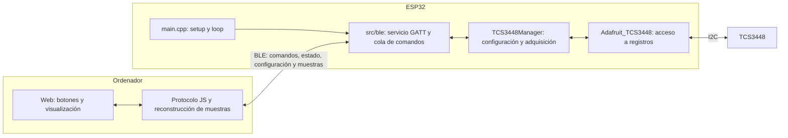
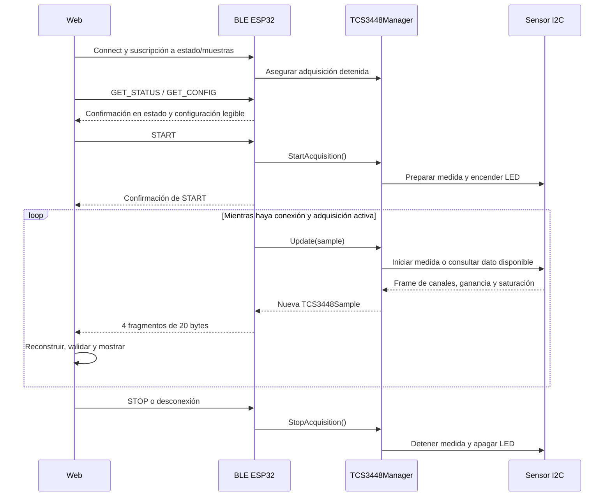

# ATLANTES / TCS3448 — Aplicación FW + BLE + Web

Aplicación para adquirir los canales espectrales de un TCS3448 desde un ESP32 y
consultarlos en un navegador mediante BLE. El firmware controla el sensor por I2C;
la página permite conectar, iniciar/parar la adquisición y mostrar muestras y
configuración. La comunicación con el ESP32 no necesita Wi-Fi ni un servidor web.

## Arquitectura general



`main.cpp` inicializa Serial, el gestor del sensor y BLE. Su bucle llama a
`AtlantesBLE::Update()`, atiende la entrada serie reservada y cede tiempo con
`delay(1)`. BLE coordina la aplicación, pero delega el acceso al sensor en
`TCS3448Manager`. Los callbacks Bluetooth encolan órdenes; las operaciones I2C y
de adquisición se ejecutan desde el bucle Arduino.

## Responsabilidades y documentación de módulos

| Ruta | Responsabilidad | Documentación |
| --- | --- | --- |
| `src/main.cpp` | Arranque y ejecución periódica | [src](src/README.md) |
| `src/TCS3448Manager/` | Configuración, estado, LED y adquisición | [README](src/TCS3448Manager/README.md) |
| `src/ble/` | Servicio ATLANTES, comandos, sesiones y transmisión | [README y protocolo](src/ble/README.md) |
| `src/SerialCommand/` | Entrada serie reservada, sin comandos activos | [README](src/SerialCommand/README.md) |
| `lib/Adafruit_TCS3448/` | Driver TCS3448 sobre Adafruit AS7343 | [README](lib/Adafruit_TCS3448/README.md) |
| `web/` | Cliente de navegador | [README](web/README.md) |
| `web/src/` | Fuentes editables de la Web y decodificador | [README](web/src/README.md) |
| `web/dist/` | HTML autocontenido para uso local/publicación | [README](web/dist/README.md) |
| `scripts/` | Generación del HTML a partir de las fuentes | [README](scripts/README.md) |

`include/` queda reservado para cabeceras compartidas. `test/` conserva una
plantilla de PlatformIO: los tests JS anteriores se han eliminado y actualmente
no hay una batería automática en esa carpeta. `Hitos/` contiene la planificación;
no interviene en la ejecución. No existen todavía módulos de análisis,
almacenamiento o calibración.

## Flujo de comandos y datos



Tras arrancar, la adquisición está detenida y el LED apagado. Si falla la
inicialización del sensor, BLE sigue disponible para consultar el error.
Desconectar cancela la adquisición al procesarse el cambio de sesión en `loop()`;
el ESP32 vuelve a anunciarse después de 200 ms. Reconectar no reinicia la
adquisición automáticamente: hay que pulsar Start.

## Protocolo de comunicación

Nombre anunciado: **ATLANTES-TCS3448**. Versión del protocolo: **1**.
Servicio: `a71a0001-3448-4c53-8a7e-41544c414e54`.

| Característica | UUID | Uso |
| --- | --- | --- |
| Estado | `a71a0002-3448-4c53-8a7e-41544c414e54` | Read + Notify, 20 bytes |
| Comandos | `a71a0003-3448-4c53-8a7e-41544c414e54` | Write con respuesta, texto ASCII |
| Muestras | `a71a0004-3448-4c53-8a7e-41544c414e54` | Notify, fragmentos de 20 bytes |
| Configuración | `a71a0005-3448-4c53-8a7e-41544c414e54` | Read, 20 bytes |

| Comando exacto, sin terminador | Acción |
| --- | --- |
| `START` | Habilitar LED y adquisición; repetirlo estando activa no la reinicia |
| `STOP` | Detener adquisición, apagar LED y cancelar fragmentos pendientes |
| `GET_STATUS` | Actualizar el estado y confirmar la consulta |
| `GET_CONFIG` | Actualizar la característica de configuración para su lectura |

La respuesta GATT a una escritura no confirma que el sensor haya ejecutado la
orden. La confirmación de aplicación llega en el estado: último comando,
resultado y contador de respuestas. La Web envía una orden cada vez, consulta
el estado hasta confirmar su ejecución y espera como máximo 3,5 s. Después de
GET_CONFIG lee la característica de configuración.

El estado incluye sensor inicializado, adquisición activa, error, total de
muestras, uptime y periodo solicitado. Se actualiza tras órdenes, cambios de
sesión, errores de adquisición y cada segundo mientras existe conexión; una
lectura directa devuelve el último estado publicado.

Los enteros multibyte son **little-endian**. Se codifican campos explícitos, no
la memoria de los structs C++. La muestra ocupa 48 bytes y viaja en cuatro
fragmentos, con secuencia e índice para reconstruirla. Véanse los
[formatos byte a byte](docs/HITO_3_BLE.md#servicio-gatt-v1) y las
[reglas del transporte](src/ble/README.md).

## Cómo se aplica la configuración

La configuración reside en `TCS3448Config`, definido en
`src/TCS3448Manager/TCS3448Types.h`. `Init()` copia la estructura, prepara I2C,
inicializa el driver y escribe ganancia, ATIME, ASTEP, modo SMUX de 18 resultados
y corriente LED. Al terminar deja la medida detenida y el LED apagado.

| Parámetro | Valor por defecto |
| --- | --- |
| SDA / SCL | GPIO 4 / GPIO 5 |
| Frecuencia I2C | 400 000 Hz |
| Ganancia | 64x |
| ATIME / ASTEP | 29 / 599 |
| Corriente LED | 10 mA |
| Periodo solicitado | 500 ms |
| Integración calculada por ciclo | 50,04 ms |

La fórmula es `(ATIME + 1) × (ASTEP + 1) × 2,78 µs`. Hay tres ciclos SMUX;
el periodo solicitado no equivale al tiempo de integración ni garantiza una
cadencia exacta de recepción.

Para cambiar valores, modificar los predeterminados o pasar una estructura en
`setup()` antes de iniciar BLE:

```cpp
TCS3448Config config;
config.gain = TCS3448_GAIN_64X;
config.sampleIntervalMs = 1000;
TCS3448Manager::Init(config);
AtlantesBLE::Init();
```

Después hay que compilar y cargar el firmware por USB. Actualmente no hay SET_CONFIG,
edición desde la Web ni guardado de configuración de usuario en memoria persistente.
GET_CONFIG serializa la copia del gestor; no relee todos los registros del sensor.
Si el sensor no se inicializó, muestra valores previstos, no una configuración
confirmada en hardware.

## Cómo se adquieren y envían muestras

`StartAcquisition()` descarta el resultado previo y habilita el LED. `Update()`
inicia una medida cuando corresponde y, en llamadas posteriores, consulta si está
disponible. No espera en un bucle a que termine la integración; las transacciones
I2C sí son síncronas. Al recibir el frame, lee canales, ganancia y saturación,
detiene esa medida y devuelve una nueva `TCS3448Sample`.

Cada muestra lleva secuencia uint32, timestamp de consulta del resultado en ms
desde el arranque, 18 valores ADC uint16, ganancia y saturación. No representa
lux ni valores calibrados. La secuencia aumenta solo con lecturas correctas;
STOP y reconexión no la reinician. Timestamp y secuencia pueden desbordarse.

BLE solo transmite con un cliente conectado y suscrito. Espacia los fragmentos
al menos 15 ms y no sustituye una transmisión incompleta por una nueva muestra;
si sigue ocupada, omite el envío de la nueva. No hay historial ni retransmisión.
La Web valida y reconstruye muestras completas, muestra los canales y contabiliza
saltos de secuencia entre muestras recibidas. Descarta fragmentos incoherentes,
fuera de orden o que superan 2 s desde el inicio de la reconstrucción.

## Arrancar y probar

1. Conectar el sensor a los pines I2C configurados y comprobar alimentación y
   niveles eléctricos adecuados para la placa utilizada.
2. Abrir el proyecto con PlatformIO y seleccionar el entorno `esp32dev`.
3. Compilar y cargar por USB desde PlatformIO o desde una terminal con `pio`:

   ```powershell
   pio run -e esp32dev
   pio run -e esp32dev -t upload
   pio device monitor -b 115200
   ```

4. Abrir `web/dist/index.html` con doble clic en un navegador con Web Bluetooth.
   El HTML contiene sus scripts y estilos: no necesita servidor ni Node para usarse.
   El navegador debe permitir Web Bluetooth en el contexto abierto; la página
   comprueba la disponibilidad y avisa si no puede usarlo.
5. Pulsar Connect y seleccionar ATLANTES-TCS3448. Comprobar estado detenido y
   configuración. Pulsar Start, variar la iluminación y comprobar los canales.
6. Pulsar Stop: el LED debe apagarse y el contador de adquisición dejar de crecer.
   Volver a iniciar y comprobar que la secuencia continúa.
7. Desconectar durante adquisición, reconectar y comprobar que sigue detenida.
   Probar también arranque sin sensor y una adquisición prolongada.

La configuración `huge_app.csv` reserva una única aplicación de **3 MiB** en
una flash de 4 MiB, sin segunda partición de aplicación para OTA. Los cambios de
firmware se cargan por USB. El HTML y los README no se almacenan en el ESP32.

Para modificar la Web, editar `web/src/` y ejecutar:

```powershell
node scripts/build-web.mjs
node --check web/src/app.mjs
node --check web/src/protocol.mjs
```

El archivo generado puede copiarse a otro equipo o publicarse en GitHub Pages.
No editar `web/dist/index.html` a mano: la siguiente generación sobrescribe sus
cambios. La compilación y las comprobaciones de sintaxis no sustituyen la prueba
física de sensor, radio y navegador. La [guía del hito 3](docs/HITO_3_BLE.md)
incluye el protocolo completo y la lista de aceptación en hardware.

## Documentación de futuros módulos

Cada nuevo módulo de análisis, almacenamiento, calibración u otra función debe
incluir su propio `README.md` y añadirse a la tabla de arquitectura de este archivo.
Usar la [plantilla de módulo](docs/MODULE_README_TEMPLATE.md): propósito, archivos,
API, entradas/salidas, configuración, flujo, errores, dependencias y pruebas.
Documentar lo implementado y separar expresamente lo previsto. Un cambio de
protocolo debe actualizar tanto firmware como Web y la descripción de sus campos.
