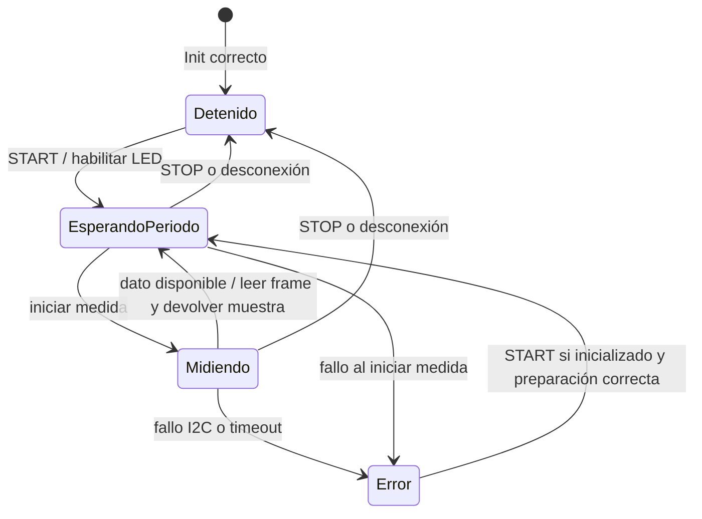

# TCS3448Manager

[Aplicación](../../README_APP.md) · [BLE](../ble/README.md) ·
[Driver](../../lib/Adafruit_TCS3448/README.md).

Gestiona el sensor, su configuración, el LED, el estado de adquisición y la
construcción de muestras. No conoce GATT, UUID ni elementos de la página Web.

## Archivos y API

| Archivo | Contenido |
| --- | --- |
| `TCS3448Types.h` | `TCS3448Config`, `TCS3448Readings`, `TCS3448Sample`, errores y estado |
| `TCS3448Manager.h` | Interfaz del namespace `TCS3448Manager` |
| `TCS3448Manager.cpp` | Instancia privada del driver y lógica de adquisición |

| Función | Responsabilidad |
| --- | --- |
| `Init(config)` | Copiar/aplicar configuración, inicializar I2C y dejar sensor detenido |
| `GetConfig()` / `GetStatus()` | Consultar referencias de solo lectura al estado del gestor |
| `StartAcquisition()` | Preparar una adquisición nueva; no reiniciar si ya está activa |
| `StopAcquisition()` | Cancelar medida pendiente, detener sensor y apagar LED |
| `Update(sample)` | Sondear la adquisición; devolver true solo con una muestra nueva |
| `LEDEnable()` | Aplicar corriente configurada y habilitar el LED |
| `GetIntegrationTime()` / `GetGain()` | Consultas al driver conservadas para diagnóstico |
| `ReadAllChannels()` / `PrintHeader()` / `PrintReadings()` | Lectura e impresión heredadas; no usadas por el flujo BLE |

`ReadAllChannels()` emplea la lectura bloqueante del driver heredado. Para mantener
la respuesta a comandos BLE, el flujo actual utiliza `Update(sample)`. No mezclar
ambos caminos durante una adquisición.

## Configuración

Valores predeterminados: SDA 4, SCL 5, 400 kHz, 64x, ATIME 29, ASTEP 599,
LED 10 mA y periodo 500 ms. `sampleIntervalMs` debe ser distinto de cero.
El modo SMUX se fija en 18 resultados. La integración por ciclo es:

```text
(ATIME + 1) × (ASTEP + 1) × 2,78 µs
```

`Init()` copia la configuración antes de intentar aplicarla. `GetConfig()` devuelve
esa copia incluso si hubo un fallo; comprobar `GetStatus().ready` antes de afirmar
que la configuración se aplicó. No hay setter durante adquisición ni persistencia
de configuración de usuario. Los cambios se incorporan al firmware y se cargan por USB.

## Flujo de adquisición



La primera medida puede iniciarse inmediatamente tras START. Las siguientes se
programan desde el inicio de la anterior, sin solapar medidas. Si la integración
consume más que el periodo solicitado, no se fuerza una cadencia imposible.

La consulta de dato disponible y la lectura son transacciones I2C síncronas, pero
no hay espera activa de la integración. El timeout se calcula como tres tiempos
de integración más 1000 ms. Una lectura correcta incrementa `sampleCount` y copia
18 canales, ganancia y saturación del mismo frame a `TCS3448Sample`.

La secuencia y el timestamp son uint32; el timestamp corresponde a la consulta
que detecta el resultado, no al instante exacto de inicio de exposición. Los ADC
son valores crudos uint16. No se calibra, normaliza ni analiza el espectro aquí.

## Errores y ejecución

Errores: None 0, Initialization 1, Configuration 2, Led 3, Communication 4,
Timeout 5. Un fallo de adquisición intenta detener medida y LED, desactiva la
adquisición y conserva el error. `ready` representa la inicialización, no la
ausencia de errores posteriores. STOP no borra un error anterior; un START
correcto lo limpia. Si falló Init, hay que corregir la causa y reiniciar.

Todas las llamadas operativas se realizan desde el bucle Arduino; el módulo no
ofrece sincronización para acceso I2C concurrente desde callbacks o varias tareas.
Depende de Arduino, Wire y `Adafruit_TCS3448`.

Validar en hardware START/STOP repetidos, respuesta a iluminación, saturación,
sensor ausente y desconexión durante medida. Véase la
[guía de aceptación](../../docs/HITO_3_BLE.md#pasos-de-aceptación-en-hardware).
